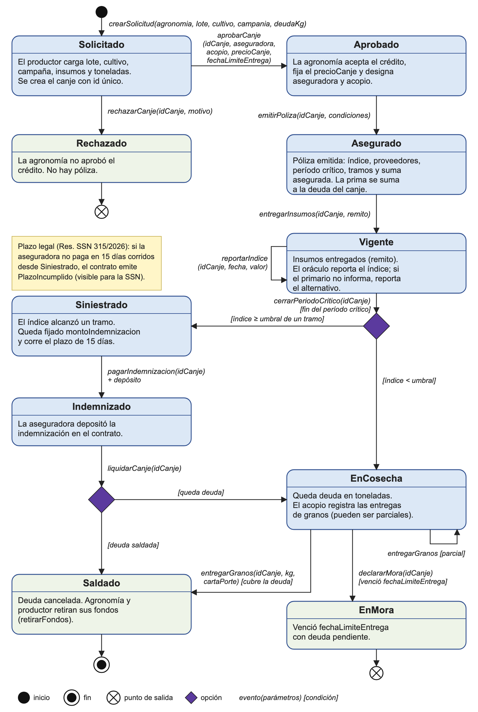

# Documento del desarrollo — TP5

# 1. Proceso trabajado en la Actividad 4

**Proceso: canje protegido.** En Argentina, buena parte de la siembra se financia con **canje**: la agronomía o cooperativa entrega hoy semillas, fertilizantes y agroquímicos, y el productor los paga con toneladas de granos en la cosecha. Si hay sequía, el productor no tiene los granos, no puede pagar, y la agronomía tampoco cobra: el riesgo climático viaja por toda la cadena comercial.

En la Actividad 4 modelamos un proceso nuevo: **el canje lleva incluido un seguro paramétrico de sequía**. La póliza la emite una aseguradora autorizada y no mide el daño en el lote, sino un **índice satelital de sequía**. Si al terminar el período crítico del cultivo el índice alcanza un umbral pactado, la indemnización se calcula sola y se reparte con una regla fija: **primero se cancela la deuda con la agronomía; el saldo es del productor**.

**Contrato inteligente: `e-CanjeProtegido`.** Representa el **activo lógico "canje protegido"**: el crédito de la agronomía sobre un lote y una campaña, con su póliza y su liquidación. Participan el productor, la agronomía, la aseguradora, el proveedor del índice (oráculo primario y alternativo), el acopio y la Superintendencia de Seguros de la Nación (SSN) como auditora. El ciclo de vida se modeló con un diagrama de transición de estados (DTE) de diez estados:

**Figura 1.** *Diagrama de transición de estados del contrato e-CanjeProtegido.*



*Nota.* Figura 3 del documento de la Actividad 4. Cada transición es una función del contrato implementado.

**Escenario de ejemplo** (el mismo de la Actividad 4, que usan las pruebas): el productor toma insumos por 210 t de soja; la prima suma 12 t, así que debe **222 t a $ 400.000/t = $ 88,8 millones**. La póliza cubre **$ 120 millones** con dos tramos: índice ≥ 600 paga el 50 % e índice ≥ 800 paga el 100 %. Con una sequía severa (índice 850) el contrato paga $ 120 millones: **$ 88,8 millones a la agronomía y $ 31,2 millones al productor**.

# 2. Tecnología Blockchain y lenguaje elegidos

**Mantenemos la elección de la Actividad 4**: una red de consorcio permisionada sobre **Hyperledger Besu** con consenso **QBFT**, y el contrato escrito en **Solidity**. Para el prototipo y la demostración usamos el **entorno de desarrollo local Hardhat** (Hardhat Network), que ejecuta la misma máquina virtual de Ethereum (EVM) que Besu: el contrato que se prueba es el mismo que se desplegaría en el consorcio.

| Criterio de la consigna | Características del caso | Por qué la tecnología elegida es adecuada |
|---|---|---|
| Proceso y activo | El activo es lógico (un crédito con su póliza); el proceso tiene estados, plazos y montos que no pueden cambiar después de firmado | Un contrato inteligente fija las reglas al firmar; la EVM ejecuta máquinas de estado con control de tiempo (`block.timestamp`) y mueve dinero tokenizado (ERC-20) en la misma transacción |
| Participantes y permisos | Organizaciones identificadas con intereses opuestos (la aseguradora calcula y paga); cada una dispara solo sus eventos | Besu permite controlar qué nodos y qué cuentas participan. En el contrato, cada evento está restringido por rol (`AccessControl`) y por parte del canje (`soloParte`) |
| Privacidad y acceso a la información | Deudas, sumas aseguradas y lotes son datos comerciales sensibles; la SSN necesita auditar en tiempo real | En una red permisionada solo leen los miembros; la SSN es un nodo más. Los documentos se guardan como *hash*, sin datos personales en la cadena |
| Adecuación de la tecnología | Se necesita costo bajo y previsible, finalidad rápida y tolerancia a fallas de algunos participantes | QBFT es el consenso que Besu recomienda para redes empresariales: finalidad inmediata y tolera que falle o actúe mal menos de un tercio de los validadores. Sin criptomoneda con valor de mercado, el gas no tiene costo especulativo |
| Adecuación del lenguaje | Hace falta un lenguaje con librerías auditadas para roles, tokens y seguridad | Solidity es el lenguaje nativo de la EVM; OpenZeppelin aporta `AccessControl`, `Pausable`, `ReentrancyGuard` y `SafeERC20`. Es además el lenguaje visto en la cátedra (Medina y Romero, 2024) |

**Por qué no otras opciones.** Una red pública (Ethereum) expone los montos de cada canje y tiene un costo de gas variable. La Blockchain Federal Argentina sirve para sellar datos, pero no para operar contratos con datos comerciales; queda como opción para anclar periódicamente el *hash* del estado del consorcio. Hyperledger Fabric también es permisionada, pero el pago con pesos tokenizados (ERC-20) y las librerías de seguridad de OpenZeppelin favorecen una red compatible con la EVM.

# 3. Correspondencia entre el modelo y lo implementado

Todos los nombres de estados, eventos y atributos son **idénticos** en el DTE, en el modelo integrado de la Actividad 4 y en el código.

| Elemento del modelo (Actividad 4) | Implementación en `ECanjeProtegido.sol` |
|---|---|
| Activo: canje protegido | Estructuras `Canje`, `Poliza` y `Liquidacion`, indexadas por `idCanje` |
| Atributos del activo | Campos de las estructuras: partes, `lote`, `cultivo`, `campania`, `insumos`, `deudaKg`, `precioCanje`, `fechaLimiteEntrega`, `estado`; umbrales, porcentajes y suma asegurada de la póliza; índice y montos de la liquidación |
| Participantes | Roles `PRODUCTOR_ROLE`, `AGRONOMIA_ROLE`, `ASEGURADORA_ROLE`, `ORACULO_ROLE`, `ACOPIO_ROLE` y `DEFAULT_ADMIN_ROLE` (consorcio) |
| Estados del DTE | `enum Estado { Solicitado, Aprobado, Asegurado, Vigente, Siniestrado, Indemnizado, EnCosecha, Saldado, Rechazado, EnMora }` |
| Eventos del DTE | Una función por evento (tabla siguiente) |
| Reglas de negocio | Modificadores `enEstado`, `soloParte`, `onlyRole`, `whenNotPaused` y validaciones con errores personalizados |
| Auditoría de la SSN | Evento `EstadoCambiado` en cada transición, más un evento por cada operación |

| Evento del DTE | Función | Quién la ejecuta | Transición |
|---|---|---|---|
| crearSolicitud | `crearSolicitud` | Productor | ● → Solicitado |
| aprobarCanje / rechazarCanje | `aprobarCanje` / `rechazarCanje` | Agronomía | Solicitado → Aprobado / Rechazado |
| emitirPoliza | `emitirPoliza` | Aseguradora | Aprobado → Asegurado |
| entregarInsumos | `entregarInsumos` | Agronomía | Asegurado → Vigente |
| reportarIndice | `reportarIndice` | Oráculo primario (o alternativo tras 5 días sin dato) | Vigente → Vigente |
| cerrarPeriodoCritico | `cerrarPeriodoCritico` | Cualquiera, después del fin del período | Vigente → Siniestrado o EnCosecha |
| pagarIndemnizacion | `pagarIndemnizacion` | Aseguradora | Siniestrado → Indemnizado |
| liquidarCanje | `liquidarCanje` | Cualquiera | Indemnizado → Saldado o EnCosecha |
| entregarGranos | `entregarGranos` | Acopio | EnCosecha → EnCosecha o Saldado |
| declararMora | `declararMora` | Agronomía, vencida la fecha de entrega | EnCosecha → EnMora |
| (notas del DTE) | `notificarPlazoIncumplido`, `retirarFondos` | Cualquiera / productor y agronomía | Sin cambio de estado |

| Regla de negocio (Actividad 4) | Cómo la cumple el código |
|---|---|
| Primero se cancela la deuda; el saldo es del productor | `liquidarCanje` aplica `min(indemnización, deuda en pesos)` a la agronomía y el resto al productor |
| Pago por tramos (Res. SSN 315/2026) | `calcularIndemnizacion` toma el tramo más alto alcanzado por el índice |
| Proveedor alternativo del dato | `reportarIndice` acepta al alternativo solo si el primario no informó en `DIAS_SIN_DATO_PRIMARIO` (5 días) |
| Pago en 15 días como máximo | `PLAZO_PAGO = 15 days`; el incumplimiento queda registrado con `PlazoIncumplido` |
| Dato y cálculo a disposición del asegurado | `verCanje`, `verPoliza`, `verLiquidacion` y `calcularIndemnizacion` son consultas públicas |
| La prima se paga con la deuda del canje | `emitirPoliza` suma `primaKg` a `deudaKg` |

# 4. Ajustes técnicos y sus motivos

Ninguno cambia el proceso ni el caso de uso. Todos ya estaban documentados en el anexo de la Actividad 4.

| Ajuste | Motivo |
|---|---|
| **Un solo contrato** para todos los canjes, cada uno como registro `idCanje` (no un contrato por canje) | Evita pagar un despliegue por canje y deja un único contrato para auditar |
| **Unidades enteras**: kg, centavos, índice de 0 a 1000, porcentajes en puntos básicos (10000 = 100 %) | Solidity no tiene decimales; los enteros evitan errores de redondeo |
| **Peso tokenizado de prueba** (`PesoToken`, ERC-20 de 2 decimales, solo el banco emite) | Simula los pesos tokenizados que emitiría el banco del consorcio |
| **Pago por retiro** (`retirarFondos`) en lugar de transferir en la liquidación | Patrón de seguridad: una transferencia fallida no bloquea a las otras partes |
| **Funciones de tiempo abiertas a cualquiera** (`cerrarPeriodoCritico`, `liquidarCanje`, `notificarPlazoIncumplido`) | Un contrato no se ejecuta solo al llegar una fecha: alguien tiene que llamarlo. El contrato verifica la fecha, así que da igual quién llame |
| **Último valor informado del índice** (índice acumulado del período) | Criterio simple; si el plan técnico de la póliza definiera otro, se cambia en `reportarIndice` |
| **Parada de emergencia** (`pausar` / `reanudar`) que no bloquea los retiros | Ante una falla de los dos oráculos se detienen los eventos sin retener fondos |
| **Oráculo como cuenta** con `ORACULO_ROLE` | El adaptador que leería el índice publicado queda fuera del prototipo |
| **Entorno Hardhat** en lugar de un consorcio Besu real | La consigna admite un entorno local; Hardhat permite adelantar el reloj para simular los meses de campaña en segundos |

# 5. Requisitos del entorno y pasos para desplegar, ejecutar y probar

**Requisitos.** Node.js 18 o superior (probado con 22.17) y npm (probado con 11.17). Todo lo demás se instala desde `package.json`: Hardhat 2.29 con `hardhat-toolbox` 5.0 (ethers v6, Mocha, Chai) y OpenZeppelin Contracts 5.1.0. Compilador Solidity 0.8.24, optimizador activado (200 ejecuciones), EVM `cancun`. No hace falta billetera: Hardhat crea 20 cuentas de prueba y firma con ellas.

**Pasos** (dentro de la carpeta `prototipo/` del ZIP):

```bash
npm ci                     # instala las dependencias exactas (package-lock.json)
npm run compile            # compila PesoToken y ECanjeProtegido
npm test                   # 11 pruebas automatizadas
npm run demo               # ensayo: las tres partes de la demostración, en la red en memoria
```

**Demostración con un nodo local persistente** (la que se usa en clase, porque muestra las transacciones en el nodo):

```bash
# terminal 1: levanta la red local (chainId 31337, 20 cuentas con 10.000 ETH de prueba)
npm run node
# terminal 2: un comando por parte de la demostración
npm run inicializar        # parte 1: despliegue, roles y fondos
npm run campania:normal    # parte 2: canje con índice de sequía 300
npm run campania:sequia    # parte 3: canje con índice de sequía 850
```

El **despliegue** lo hace `npm run inicializar`: `PesoToken(banco)`, `ECanjeProtegido(token, admin)`, la asignación de roles con `grantRole` y la emisión de pesos tokenizados para la aseguradora; las direcciones quedan en `despliegue.json` y las campañas las usan. Los comandos son iguales en macOS y Windows. Como alternativa sin instalación, el `README.md` explica cómo desplegar y recorrer el DTE en **Remix** (Remix VM).

# 6. Casos de prueba de la demostración

La demostración se ejecuta con **tres comandos** sobre el nodo local, uno por parte:

| Parte | Comando | Qué hace |
|---|---|---|
| 1. Inicialización | `npm run inicializar` | Despliega los contratos, asigna los roles y emite los fondos |
| 2. Año normal | `npm run campania:normal` | Campaña completa de un canje; el oráculo informa un índice de sequía de **300** |
| 3. Sequía severa | `npm run campania:sequia` | La misma campaña; el oráculo informa **850** |

Las dos campañas ejecutan **los mismos pasos** con las condiciones del escenario de la Actividad 4 (210 t de insumos, $ 400.000/t, póliza de $ 120 M con tramos [600, 800] → [50 %, 100 %] y prima de 12 t). Solo cambia el índice: **el contrato decide** el camino al cerrar el período crítico. Para cada caso, la salida muestra la operación, quién la ejecuta, el resultado esperado, el obtenido y una verificación **[OK]**, con la numeración de estas tablas; al final de cada caso, el comando se detiene hasta que se aprieta Enter.

**Parte 1. Inicialización** (`npm run inicializar`)

| N.º | Operación | Ejecuta | Resultado esperado |
|:-:|---|---|---|
| 1 | Despliegue de `PesoToken(banco)` y `ECanjeProtegido(token, admin)` | Administrador | Dos contratos con su dirección en la red |
| 2 | `grantRole` para cada participante | Administrador | Seis cuentas con rol; una cuenta sin rol (intruso) |
| 3 | `emitir` $ 200 M para la aseguradora; `approve` al contrato | Banco y aseguradora | Saldo de la aseguradora $ 200 M |

**Partes 2 y 3. Campaña de un canje** (`npm run campania:normal` y `npm run campania:sequia`)

| N.º | Exigencia de la consigna | Operación | Resultado esperado: año normal (300) | Resultado esperado: sequía severa (850) |
|:-:|---|---|---|---|
| 1 | Creación del activo | `crearSolicitud` (productor): soja, 2026, 210.000 kg | Canje nuevo en `Solicitado`; evento `CanjeSolicitado` | Igual |
| 2 | Rechazo sin permisos | `crearSolicitud` desde una cuenta sin rol; `aprobarCanje` desde el productor | Reversión `AccessControlUnauthorizedAccount` y `NoEsLaParte`; el estado no cambia | Igual |
| 3 | Recorrido válido | `aprobarCanje` (agronomía), $ 400.000/t | `Solicitado` → `Aprobado` | Igual |
| 4 | Rechazo de transición inválida | `entregarInsumos` sin póliza emitida | Reversión `EstadoInvalido` (estado actual `Aprobado`, esperado `Asegurado`); el estado no cambia | Igual |
| 5 | Recorrido válido | `emitirPoliza` (aseguradora), `entregarInsumos` (agronomía) | `Aprobado` → `Asegurado` → `Vigente`; deuda 222 t | Igual |
| 6 | Consulta de datos y estado | `verCanje`, `verPoliza`, `calcularIndemnizacion` con el índice de la campaña | Deuda 222 t = $ 88,8 M; con 300 la póliza pagaría $ 0 | Con 850 la póliza pagaría $ 120 M |
| 7 | Regla del oráculo | `reportarIndice` del primario; intento del alternativo | Índice 300 registrado; el alternativo es rechazado (`OraculoNoHabilitado`) | Índice 850 registrado; ídem |
| 8 | El contrato decide | `cerrarPeriodoCritico` (cualquier cuenta) | 300 < 600: `Vigente` → `EnCosecha`, indemnización $ 0 | 850 ≥ 800: `Vigente` → `Siniestrado`, indemnización $ 120 M (100 %) |
| 9 | Recorrido hasta el final | Normal: intento de `pagarIndemnizacion`, `entregarGranos` (acopio). Sequía: `pagarIndemnizacion`, `liquidarCanje`, `retirarFondos` | El pago se rechaza (`EstadoInvalido`); entregas de 100 t y 122 t: `EnCosecha` → `Saldado` | `Indemnizado` → `Saldado`; $ 88,8 M a la agronomía y $ 31,2 M al productor; un segundo retiro es rechazado (`NadaParaRetirar`) |
| 10 | Consulta final | Resumen de la campaña | Aseguradora pagó $ 0; 222 t en granos; canje `Saldado` | Aseguradora pagó $ 120 M; 0 t en granos; canje `Saldado` |

Además, las **11 pruebas automatizadas** (`npm test`) cubren los demás caminos del DTE (sequía moderada, rechazo, mora) y reglas (plazo de 15 días, cierre del período, validación de la póliza, parada de emergencia). Resultado verificado antes de la entrega: **11 de 11 pruebas aprobadas**; en la demostración, **3 de 3** verificaciones en la inicialización, **16 de 16** en la campaña normal y **18 de 18** en la de sequía, sobre el nodo local (y 37 de 37 con `npm run demo`, en memoria).

# 7. Limitaciones del prototipo

- Corre en una red local de Hardhat, no en un consorcio Besu con varios nodos y validadores QBFT. El código no cambia, pero no se probó el despliegue en Besu.
- El oráculo es una cuenta de prueba: falta el adaptador que leería el índice publicado por el proveedor.
- El peso tokenizado es simulado; no hay un banco real que lo respalde.
- No tiene interfaz gráfica: se opera por scripts, pruebas o Remix.
- No tiene auditoría de seguridad externa ni optimización de gas.
- El pago de la prima de la agronomía a la aseguradora no está modelado (la prima solo se suma a la deuda en kg).
- Las claves de las cuentas son las de prueba de Hardhat, públicas; en el consorcio cada organización firmaría con una billetera institucional.

# 8. Fuentes consultadas

Hardhat. (s.f.). *Hardhat documentation*. Nomic Foundation. https://hardhat.org/docs

Hyperledger Besu. (s.f.). *Configure QBFT consensus*. Linux Foundation Decentralized Trust. Recuperado el 29 de octubre de 2026, de https://docs.besu-eth.org/private-networks/how-to/configure/consensus/qbft

Jimenez, G. M., Martos, L. A., Romero, G. A., y Scrimaglia, E. (2026). *Actividad 4: Modelado de un contrato inteligente. «Canje protegido» – contrato e-CanjeProtegido* [Trabajo práctico]. Universidad Tecnológica Nacional, Facultad Regional Córdoba.

Medina, O. C., y Romero, R. A. (2024). *Ethereum – Solidity* [Diapositivas de clase]. Universidad Tecnológica Nacional, Facultad Regional Córdoba.

OpenZeppelin. (s.f.). *OpenZeppelin Contracts 5.x documentation*. https://docs.openzeppelin.com/contracts/5.x/

Solidity. (s.f.). *Solidity documentation* (v0.8.24). https://docs.soliditylang.org/en/v0.8.24/

Superintendencia de Seguros de la Nación. (2026). *Resolución 315/2026: Modificación del RGAA punto 23 – Seguros paramétricos* (RESOL-2026-315-APN-SSN#MEC). Boletín Oficial de la República Argentina, 23 de julio de 2026. https://www.boletinoficial.gob.ar/detalleAviso/primera/344848/20260723

Wöhrer, M., y Zdun, U. (2018). Design patterns for smart contracts in the Ethereum ecosystem. En *2018 IEEE International Conference on Internet of Things (iThings) and IEEE Green Computing and Communications (GreenCom) and IEEE Cyber, Physical and Social Computing (CPSCom) and IEEE Smart Data (SmartData)* (pp. 1513–1520). IEEE. https://doi.org/10.1109/Cybermatics_2018.2018.00255

# 9. Declaración de uso de inteligencia artificial

Usamos Claude (Anthropic, modelo Opus 5.5) a través de Claude Code como asistente. El código del contrato es el del prototipo de la Actividad 4, revisado por el grupo; en este trabajo la IA no cambió el contrato.

| Fecha | Herramienta | Uso | Cómo se verificó |
|---|---|---|---|
| 29/10 | Claude (Opus 5.5) | Borrador del contrato, del token y de las 11 pruebas (Actividad 4) | Compilado sin advertencias; 11/11 pruebas; nombres iguales al DTE; revisión del código por el grupo |
| 15/11 | Claude (Opus 5.5) | Análisis de la consigna del TP5; script de demostración `demo.js` | El script se ejecutó en la red en memoria y en un nodo local: 17/17 verificaciones; cada resultado se contrastó con el escenario de la Actividad 4 |
| 15/11 | Claude (Opus 5.5) | Borradores de este documento y de dos documentos internos del grupo (documento técnico de estudio y guía de la demostración) | Contrastados con el código, la salida real de las pruebas y el documento de la Actividad 4; revisados por el grupo |
| 15/11 | Claude (Opus 5.5) | Configuración del repositorio compartido (`.gitignore`, entorno de Python con uv, instrucciones del README) | Se ejecutaron `uv sync` y la generación de los PDF; se revisó que no hubiera claves en la configuración |
| 15/11 | Claude (Opus 5.5) | Script `demo:clase`, para correr la demostración con el mismo comando en macOS y Windows | Se ejecutaron las pruebas y la demostración en la red en memoria y en el nodo local: 11/11 y 17/17 |
| 15/11 | Claude (Opus 5.5) | Apartado del documento técnico interno que compara la red del prototipo con la de la propuesta y justifica la demo local | Contrastado con la consigna, el script de demostración y las limitaciones de este documento |
| 15/11 | Claude (Opus 5.5) | Revisión del contenido del ZIP y de las referencias de este documento | Contrastado con la lista de la entrega de la consigna |
| 15/11 | Claude (Opus 5.5) | Reorganización del script de demostración en tres partes: inicialización, año normal y sequía severa | Se ejecutó en la red en memoria y en el nodo local: 26/26 verificaciones; 11/11 pruebas; el contrato no se modificó |
| 15/11 | Claude (Opus 5.5) | División de la demostración en tres comandos (inicialización y dos campañas que ejecutan el mismo código con distinto índice) | Se ejecutaron sobre el nodo local en distintos órdenes y repetidos, y en memoria: todas las verificaciones correctas; 11/11 pruebas; el contrato no se modificó |

# Anexo: contenido del ZIP

| Ruta | Contenido |
|---|---|
| `TP5_Desarrollo.pdf` | Este documento |
| `prototipo/contracts/` | `ECanjeProtegido.sol` y `PesoToken.sol` (código fuente) |
| `prototipo/test/` | `ECanjeProtegido.test.js` (11 pruebas) |
| `prototipo/scripts/demo.js` | Script de la demostración |
| `prototipo/hardhat.config.js`, `package.json`, `package-lock.json` | Configuración y dependencias exactas |
| `prototipo/README.md` | Instrucciones de ejecución (Hardhat y Remix) |

El ZIP no incluye `node_modules` (se instala con `npm ci`) ni contraseñas, claves privadas o credenciales: las únicas cuentas son las de prueba que Hardhat genera al iniciar.
