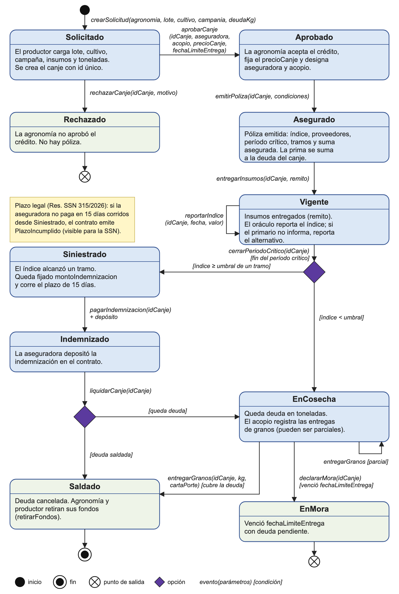

# Documento técnico del código — e-CanjeProtegido

# 1. Para qué sirve este documento

Es el material de **estudio** del prototipo. Explica los conceptos necesarios, la red donde corre y cada parte del código, con fragmentos copiados textualmente de `prototipo/contracts/ECanjeProtegido.sol`. La consigna pide que **todos los integrantes puedan explicar las decisiones tomadas y el código**: con este documento cualquiera debería poder responder una pregunta sobre cualquier función.

**El contrato en una frase.** `e-CanjeProtegido` registra un canje de insumos por granos que lleva incluido un seguro paramétrico de sequía; si el índice alcanza un tramo de la póliza, calcula la indemnización, **cancela primero la deuda con la agronomía** y deja el saldo para el productor, sin denuncia de siniestro ni aprobación manual.

# 2. Conceptos base

| Concepto | Qué es | Dónde aparece en el proyecto |
|---|---|---|
| **Blockchain** | Registro compartido entre nodos, en bloques encadenados por *hash*; lo registrado no se puede borrar ni modificar | Las partes del canje y la SSN comparten un mismo registro |
| **Contrato inteligente** | Programa desplegado en la cadena, con código y datos propios; todos los nodos lo ejecutan igual y sus reglas no cambian después del despliegue | `ECanjeProtegido`: los tramos y la regla de reparto quedan fijos |
| **EVM** | Máquina virtual de Ethereum: ejecuta el *bytecode* que resulta de compilar Solidity | Hardhat, Remix y Besu ejecutan la misma EVM |
| **Cuenta y dirección** | Par de claves; la dirección (`address`, 20 bytes) identifica a la cuenta. `msg.sender` es quien firmó la llamada | El contrato decide los permisos con `msg.sender` |
| **Transacción** | Llamada firmada que cambia el estado y queda en un bloque. Si una validación falla, se **revierte entera** | Cada evento del DTE es una transacción |
| **Consulta (`view`)** | Lectura que no cambia el estado: no es transacción y no consume gas | `verCanje`, `verPoliza`, `verLiquidacion`, `calcularIndemnizacion` |
| **Gas** | Medida del cómputo de una transacción; en una red pública se paga en criptomoneda | En el consorcio no tiene valor de mercado |
| **Evento (*log*)** | Registro que emite el contrato y que se consulta desde afuera | `EstadoCambiado` deja el historial de cada canje |
| **ABI** | Interfaz del contrato (funciones, parámetros, errores, eventos) en JSON; la usan los programas para llamarlo | Hardhat la genera al compilar, en `artifacts/` |
| **Token ERC-20** | Estándar de token fungible: `balanceOf`, `transfer`, `approve`, `transferFrom` | `PesoToken`: pesos tokenizados |
| **Oráculo** | Servicio que lleva a la cadena un dato externo | El proveedor del índice informa con `reportarIndice` |
| **Hash** | Huella digital de un dato (`keccak256`); si cambia un carácter, cambia el hash | Lote, remito, condiciones y roles se guardan como `bytes32` |
| **Tiempo en la cadena** | `block.timestamp` es la hora del bloque; el contrato no se ejecuta solo al llegar una fecha | Las funciones de tiempo las llama cualquiera y el contrato controla la fecha |

# 3. La red Blockchain

## 3.1 Red objetivo: consorcio permisionado sobre Hyperledger Besu

**Tipo de red: permisionada, de consorcio.** No es pública (no entra cualquiera) ni privada de una sola empresa: la operan varias organizaciones identificadas.

| Aspecto | Cómo es |
|---|---|
| **Cliente** | Hyperledger Besu: cliente de Ethereum de código abierto (Linux Foundation Decentralized Trust), compatible con la EVM y con permisos de nodos y cuentas |
| **Participantes** | Aseguradoras, cooperativas y agronomías, acopios, el banco que emite los pesos tokenizados y la **SSN** como nodo validador u observador |
| **Consenso** | **QBFT** (*Quorum Byzantine Fault Tolerance*), el recomendado por Besu para redes empresariales: un conjunto de validadores conocidos acuerda cada bloque por votación; la finalidad es inmediata (un bloque confirmado no se revierte) y tolera que falle o actúe mal menos de un tercio de los validadores |
| **Acceso a la información** | Solo los miembros leen la cadena: deudas y sumas aseguradas no quedan públicas |
| **Costo** | Sin criptomoneda con valor de mercado: gas bajo y previsible |
| **Dinero** | Pesos tokenizados (ERC-20) emitidos por el banco miembro, 1 a 1 |
| **Transparencia pública (opcional)** | Anclaje periódico del *hash* del estado en la Blockchain Federal Argentina |

## 3.2 Red del prototipo: Hardhat Network

Para el prototipo y la demostración usamos **Hardhat Network**, una red Ethereum de desarrollo que corre en la computadora.

| Característica | Detalle |
|---|---|
| Identificador | `chainId` 31337 |
| Modos | **En memoria** (`npm test`, `npm run demo`): nace y muere con el comando. **Nodo local** (`npm run node`, que ejecuta `npx hardhat node`): servidor JSON-RPC en `http://127.0.0.1:8545`, al que se conectan scripts con `--network localhost` |
| Bloques | *Automining*: cada transacción se mina en su propio bloque al instante |
| Cuentas | 20 cuentas de prueba con 10.000 ETH de prueba cada una; sus claves salen de una frase semilla pública y conocida, así que **no sirven fuera de la red local** |
| Reloj | Se puede adelantar (`time.increaseTo` de `hardhat-network-helpers`) para simular meses de campaña en segundos |
| Errores | Decodifica los errores personalizados del contrato y muestra la traza |

**¿Y la billetera?** No hace falta. Los scripts toman las cuentas con `ethers.getSigners()` y firman con `contrato.connect(cuenta)`. En el consorcio, cada organización firmaría con una billetera institucional (servicio de firma o módulo HSM).

## 3.3 Dónde corre, dónde correría y por qué la demo es local

| | Hoy (prototipo y demostración) | Según la propuesta (Actividad 4) |
|---|---|---|
| **Red** | Hardhat Network, en la computadora | Consorcio Hyperledger Besu |
| **Tipo** | Local, de un solo nodo, sin conexión a otras máquinas | Permisionada, de consorcio, con un nodo por organización |
| **Consenso** | No hay: un solo nodo mina cada transacción al instante | QBFT entre validadores conocidos |
| **Cuentas** | 20 cuentas de prueba con claves públicas | Billeteras institucionales de cada organización |
| **Reloj** | Se puede adelantar | Hora real; no se puede mover |
| **Contrato** | `ECanjeProtegido` y `PesoToken` | Los mismos, sin cambios (misma EVM) |

**Del prototipo al consorcio.** El código del contrato no cambia, porque Besu ejecuta la misma EVM. Los pasos serían:

1. Levantar la red: varios nodos Besu (con Docker o con Besu instalado sobre Java). QBFT tolera que falle menos de un tercio de los validadores, así que hacen falta **4 validadores** para tolerar una falla; con uno solo la red funciona, pero no muestra consenso.
2. Escribir el `genesis.json`: consenso QBFT, la versión de la EVM con la que se compila el contrato (`cancun`) y saldo para las cuentas de los roles, o gas a precio 0.
3. Agregar la red en `hardhat.config.js`: la URL de un nodo y la cuenta que despliega, con su clave leída de una variable de entorno, nunca escrita en el código.
4. Desplegar `PesoToken` y `ECanjeProtegido`; el administrador asigna los roles y cada organización opera desde sus sistemas.
5. Adaptar la demostración: las campañas (`scripts/lib/campania.js`) usan `time.increaseTo` para saltar al día 40 del período crítico y al fin del período. Esa función es propia de Hardhat; en Besu el reloj es el real, así que habría que usar plazos de minutos y esperar, como en la alternativa con Remix.

**Por qué preferimos correr la demo localmente.**

- **El contrato es el mismo.** Besu ejecuta la misma EVM que Hardhat: lo que se demuestra (estados, eventos, permisos, cálculo y pagos) no cambia de una red a otra.
- **La campaña se ve completa en minutos.** El proceso dura meses (período crítico, cosecha, plazo de 15 días para la mora). Hardhat adelanta el reloj; en una red real habría que acortar los plazos y esperar, y algunos caminos no se podrían mostrar en una clase.
- **Menos riesgo en vivo.** La demo depende solo de Node.js: corre igual en macOS y Windows, sin Docker, sin red y sin varios nodos que coordinar.
- **La consigna lo admite.** En el punto 3 pide "preparar un entorno de desarrollo local, una red de prueba o un entorno de ejecución provisto por la tecnología seleccionada", que esté "instalado, configurado y listo para utilizarse al comenzar la presentación". En el punto 4 exige que las pruebas se ejecuten **en vivo** durante la clase: "las capturas, los registros o los videos preparados previamente podrán utilizarse como material complementario, pero no reemplazarán la ejecución de las pruebas". El nodo local de Hardhat es un entorno de desarrollo local y la demo se ejecuta en vivo sobre él.
- **Es una limitación declarada.** El despliegue en un consorcio Besu real no se probó (apartado 7 del documento del desarrollo); queda como siguiente paso, y el código está preparado para hacerlo sin modificar el contrato.

# 4. Estructura del proyecto y herramientas

| Archivo | Qué es |
|---|---|
| `contracts/ECanjeProtegido.sol` | El contrato (568 líneas): estados, datos, un método por evento del DTE, roles, validaciones, eventos |
| `contracts/PesoToken.sol` | Peso tokenizado de prueba: ERC-20 de 2 decimales (1 unidad = 1 centavo), solo el banco emite |
| `test/ECanjeProtegido.test.js` | 11 pruebas automatizadas (Mocha + Chai) |
| `scripts/inicializar.js`, `campania-normal.js`, `campania-sequia.js` | Los tres comandos de la demostración: inicialización y las dos campañas (índice 300 y 850). Usan `scripts/lib/` (formato de la salida, despliegue y la campaña) |
| `scripts/demo.js` | Ensayo: las tres partes seguidas, en la red en memoria |
| `hardhat.config.js` | Solidity 0.8.24, optimizador (200 ejecuciones), EVM `cancun` |
| `package.json` / `package-lock.json` | Dependencias y versiones exactas; scripts `compile`, `test`, `node`, `inicializar`, `campania:normal`, `campania:sequia`, `demo` |

**Herramientas.**
- **Solidity 0.8.24**: desde la 0.8 controla el desbordamiento aritmético (una suma que excede el tipo revierte).
- **OpenZeppelin Contracts 5.1.0**: librerías auditadas. `AccessControl` (roles), `Pausable` (parada de emergencia), `ReentrancyGuard`, `SafeERC20`, y `ERC20` y `Ownable` para el token.
- **Hardhat 2.29** con `hardhat-toolbox`: compila, ejecuta la red, corre las pruebas; incluye **ethers v6** (biblioteca para llamar al contrato desde JavaScript), **Chai** (aserciones) y `hardhat-network-helpers` (reloj).

**Ciclo de compilación.** `npx hardhat compile` invoca al compilador `solc` y deja en `artifacts/` el *bytecode* y la ABI de cada contrato. Desplegar es mandar una transacción con ese *bytecode*: la red le asigna una **dirección** fija al contrato.

# 5. El contrato ECanjeProtegido, parte por parte

## 5.1 Encabezado, librerías y herencia

```solidity
pragma solidity ^0.8.24;
import {AccessControl} from "@openzeppelin/contracts/access/AccessControl.sol";
import {Pausable} from "@openzeppelin/contracts/utils/Pausable.sol";
import {ReentrancyGuard} from "@openzeppelin/contracts/utils/ReentrancyGuard.sol";
import {IERC20} from "@openzeppelin/contracts/token/ERC20/IERC20.sol";
import {SafeERC20} from "@openzeppelin/contracts/token/ERC20/utils/SafeERC20.sol";

contract ECanjeProtegido is AccessControl, Pausable, ReentrancyGuard {
    using SafeERC20 for IERC20;
```

- `pragma` fija la versión mínima del compilador.
- El contrato **hereda** tres contratos de OpenZeppelin: obtiene `hasRole`, `grantRole`, `onlyRole` (roles), `whenNotPaused`, `_pause` (pausa) y `nonReentrant`.
- `using SafeERC20 for IERC20` agrega `safeTransfer` y `safeTransferFrom` al token, que revierten si la transferencia falla.
- El código está documentado con **NatSpec** (`@title`, `@notice`, `@dev`, `@param`) en español.

## 5.2 Roles y parámetros

```solidity
bytes32 public constant PRODUCTOR_ROLE = keccak256("PRODUCTOR_ROLE");
bytes32 public constant AGRONOMIA_ROLE = keccak256("AGRONOMIA_ROLE");
bytes32 public constant ASEGURADORA_ROLE = keccak256("ASEGURADORA_ROLE");
bytes32 public constant ACOPIO_ROLE = keccak256("ACOPIO_ROLE");
bytes32 public constant ORACULO_ROLE = keccak256("ORACULO_ROLE");

uint64 public constant PLAZO_PAGO = 15 days;
uint64 public constant DIAS_SIN_DATO_PRIMARIO = 5 days;
uint16 public constant INDICE_MAX = 1000;
uint16 public constant BPS = 10000;
```

- Cada rol es el hash de su nombre. `DEFAULT_ADMIN_ROLE` (heredado) es el administrador del consorcio.
- `constant`: el valor queda en el *bytecode*, no ocupa almacenamiento ni se puede cambiar. `15 days` es azúcar sintáctico de Solidity: 1.296.000 segundos.
- **Unidades:** toneladas en **kg**, dinero en **centavos**, índice de **0 a 1000**, porcentajes en **puntos básicos** (`BPS` = 10000 = 100 %). Solidity no tiene decimales.

| Rol | Participante | Puede |
|---|---|---|
| `PRODUCTOR_ROLE` | Productor | `crearSolicitud`; retirar su saldo |
| `AGRONOMIA_ROLE` | Agronomía o cooperativa | `aprobarCanje`, `rechazarCanje`, `entregarInsumos`, `declararMora`; retirar |
| `ASEGURADORA_ROLE` | Aseguradora | `emitirPoliza`, `pagarIndemnizacion` |
| `ORACULO_ROLE` | Proveedor del índice | `reportarIndice` (si es el primario o alternativo de la póliza) |
| `ACOPIO_ROLE` | Acopio | `entregarGranos` |
| `DEFAULT_ADMIN_ROLE` | Consorcio | `grantRole`, `revokeRole`, `pausar`, `reanudar` |

## 5.3 Tipos: estados y estructuras

```solidity
enum Estado { Solicitado, Aprobado, Asegurado, Vigente, Siniestrado,
              Indemnizado, EnCosecha, Saldado, Rechazado, EnMora }
```

El `enum` son los diez estados del DTE; internamente es un número de 0 a 9 (por eso un error muestra `EstadoInvalido(1, 1, 2)`: Aprobado = 1, Asegurado = 2).

**Figura 1.** *Diagrama de transición de estados del contrato.*



*Nota.* Figura 3 del documento de la Actividad 4.

| Estructura | Qué representa | Campos |
|---|---|---|
| `Canje` | El activo: crédito de la agronomía sobre un lote y una campaña | `productor`, `agronomia`, `aseguradora`, `acopio` (address); `lote`, `insumos` (bytes32, hash); `cultivo` (string); `campania` (uint16); `deudaKg`, `precioCanje` (uint256); `fechaLimiteEntrega` (uint64); `estado` |
| `Poliza` | Condiciones del seguro (Res. SSN 315/2026) | `idPoliza`, `condiciones` (hash); `proveedorPrimario`, `proveedorAlternativo`; `inicioPeriodo`, `finPeriodo`; `umbrales[]`, `porcentajes[]` (uint16); `sumaAsegurada`, `primaKg` |
| `Liquidacion` | Dato del índice y resultado del cálculo | `valorIndice`, `fuenteIndice`, `fechaIndice`, `ultimoReportePrimario`, `fechaSiniestro`, `montoIndemnizacion`, `montoAplicadoDeuda`, `saldoProductor`, `plazoIncumplidoNotificado` |

## 5.4 Almacenamiento

```solidity
IERC20 public immutable pesoToken;
uint256 public cantidadCanjes;
mapping(uint256 => Canje) private _canjes;
mapping(uint256 => Poliza) private _polizas;
mapping(uint256 => Liquidacion) private _liquidaciones;
mapping(address => uint256) public fondosPendientes;
```

- **Un único contrato para todos los canjes** (no un contrato por canje): cada canje es un registro identificado por `idCanje`. `cantidadCanjes` es el contador que asigna los números.
- `immutable`: se fija en el constructor y no cambia.
- `private` no oculta los datos (en la cadena todo es legible para los nodos); solo impide que otros contratos los lean directamente. Por eso hay funciones de consulta.
- `fondosPendientes`: lo que cada cuenta puede retirar (pago por retiro).

## 5.5 Errores personalizados y eventos

```solidity
error CanjeInexistente(uint256 idCanje);
error EstadoInvalido(uint256 idCanje, Estado actual, Estado esperado);
error NoEsLaParte(uint256 idCanje, address esperada, address recibida);
error RolFaltante(address cuenta, bytes32 rol);
error ParametroInvalido(string detalle);
error FueraDePlazo(string detalle);
error OraculoNoHabilitado(address cuenta);
error SinDatoDelIndice(uint256 idCanje);
error NadaParaRetirar();
```

Con `revert Error(...)` la transacción se deshace y devuelve el error con sus datos: dicen **qué** falló y **con qué valores**, y cuestan menos gas que un texto. Los **eventos** (`CanjeSolicitado`, `PolizaEmitida`, `IndiceReportado`, `CanjeLiquidado`, `EstadoCambiado`, etc.) quedan en los *logs* de la cadena: la SSN reconstruye el historial de cada canje sin pedirle datos a nadie.

## 5.6 Modificadores: cómo se controla cada transición

```solidity
modifier existe(uint256 idCanje) {
    if (_canjes[idCanje].productor == address(0)) revert CanjeInexistente(idCanje);
    _;
}
modifier enEstado(uint256 idCanje, Estado esperado) {
    Estado actual = _canjes[idCanje].estado;
    if (actual != esperado) revert EstadoInvalido(idCanje, actual, esperado);
    _;
}
modifier soloParte(uint256 idCanje, address esperada) {
    if (msg.sender != esperada) revert NoEsLaParte(idCanje, esperada, msg.sender);
    _;
}
```

Un modificador se ejecuta **antes** del cuerpo de la función; `_;` marca dónde sigue la función. Se combinan así:

```solidity
function aprobarCanje(uint256 idCanje, address aseguradora, address acopio,
                      uint256 precioCanje, uint64 fechaLimiteEntrega)
    external
    whenNotPaused                                  // el contrato no está pausado
    existe(idCanje)                                // el canje existe
    enEstado(idCanje, Estado.Solicitado)           // máquina de estados
    soloParte(idCanje, _canjes[idCanje].agronomia) // la agronomía de ESE canje
```

- `enEstado` es la **máquina de estados**: solo se aceptan las transiciones del DTE.
- `onlyRole` (OpenZeppelin) exige el rol; `soloParte` va más allá: exige ser **la parte de ese canje**.
- Todo cambio de estado pasa por `_cambiarEstado`, que emite `EstadoCambiado(idCanje, desde, hacia)`.

## 5.7 Las funciones, en el orden del ciclo de vida

| Función | Quién | Transición | Qué valida o hace |
|---|---|---|---|
| `constructor(token, admin)` | Despliegue | — | Guarda el token; da `DEFAULT_ADMIN_ROLE` al admin |
| `crearSolicitud` | Productor (`onlyRole`) | ● → Solicitado | La agronomía tiene su rol; deuda > 0; lote no vacío. Asigna `idCanje = ++cantidadCanjes` |
| `aprobarCanje` | Agronomía del canje | Solicitado → Aprobado | Aseguradora y acopio con su rol; precio > 0; fecha límite futura |
| `rechazarCanje` | Agronomía del canje | Solicitado → Rechazado | Registra el motivo (estado final) |
| `emitirPoliza` | Aseguradora del canje | Aprobado → Asegurado | `_validarPoliza`; **suma la prima a la deuda** |
| `entregarInsumos` | Agronomía del canje | Asegurado → Vigente | Antes del inicio del período crítico; remito no vacío |
| `reportarIndice` | Oráculo de la póliza | Vigente → Vigente | Primario siempre; alternativo solo tras 5 días sin dato; fecha dentro del período y no futura; valor ≤ 1000 |
| `cerrarPeriodoCritico` | Cualquiera | Vigente → Siniestrado o EnCosecha | Terminó el período; hay dato del índice; calcula el monto |
| `pagarIndemnizacion` | Aseguradora del canje | Siniestrado → Indemnizado | Deposita el monto (requiere `approve` previo); marca si pagó fuera de los 15 días |
| `notificarPlazoIncumplido` | Cualquiera (p. ej., la SSN) | Siniestrado (sin cambio) | Pasaron 15 días sin pago; emite `PlazoIncumplido` una sola vez |
| `liquidarCanje` | Cualquiera | Indemnizado → Saldado o EnCosecha | Reparte: primero la deuda, el resto al productor |
| `entregarGranos` | Acopio del canje | EnCosecha → EnCosecha o Saldado | Resta los kg; en cero, Saldado |
| `declararMora` | Agronomía del canje | EnCosecha → EnMora | Venció la fecha límite con deuda |
| `retirarFondos` | Quien tenga saldo | — | Transfiere lo asignado; no se bloquea con la pausa |
| `pausar` / `reanudar` | Admin | — | Parada de emergencia |

**Validación de la póliza (`_validarPoliza`).** Exige que los dos proveedores tengan `ORACULO_ROLE` y sean distintos; que el período sea futuro y termine antes de la fecha de entrega; suma asegurada > 0; igual cantidad de umbrales y porcentajes; umbrales ≤ 1000 y **estrictamente crecientes**; porcentajes entre 1 y 10000 y no decrecientes.

**El oráculo con proveedor alternativo** (exigencia de la Res. SSN 315/2026):

```solidity
if (msg.sender == p.proveedorPrimario) {
    l.ultimoReportePrimario = uint64(block.timestamp);
} else if (msg.sender == p.proveedorAlternativo) {
    uint64 desde = l.ultimoReportePrimario > p.inicioPeriodo
        ? l.ultimoReportePrimario : p.inicioPeriodo;
    if (block.timestamp < desde + DIAS_SIN_DATO_PRIMARIO) revert OraculoNoHabilitado(msg.sender);
} else {
    revert OraculoNoHabilitado(msg.sender);   // nadie más, tampoco la aseguradora
}
```

Se conserva el **último valor informado** (índice acumulado del período).

**El cálculo de la indemnización** (consulta pública):

```solidity
for (uint256 i = 0; i < p.umbrales.length; i++) {
    if (valor >= p.umbrales[i]) tramo = i + 1;
}
if (tramo > 0) monto = (p.sumaAsegurada * p.porcentajes[tramo - 1]) / BPS;
```

| Índice | Tramo | Indemnización (suma $ 120 M) | Estado al cerrar el período |
|:-:|:-:|---|---|
| 300 | ninguno | $ 0 | EnCosecha (se paga con granos) |
| 680 | 1.º (50 %) | $ 60 M | Siniestrado |
| 850 | 2.º (100 %) | $ 120 M | Siniestrado |

**El reparto: primero la deuda** (`liquidarCanje`):

```solidity
uint256 deudaPesos = (c.deudaKg * c.precioCanje) / 1000;
uint256 aplicado = l.montoIndemnizacion < deudaPesos ? l.montoIndemnizacion : deudaPesos;
uint256 saldo = l.montoIndemnizacion - aplicado;
fondosPendientes[c.agronomia] += aplicado;
fondosPendientes[c.productor] += saldo;
```

Con 222 t a $ 400.000/t la deuda es $ 88,8 M. **Índice 850:** se aplica todo, Saldado, y el productor recibe $ 31,2 M. **Índice 680:** los $ 60 M cancelan 150 t (60.000.000 × 1000 / 400.000 = 150.000 kg) y quedan 72 t en EnCosecha.

## 5.8 Movimiento de fondos y seguridad

```solidity
function pagarIndemnizacion(uint256 idCanje) external whenNotPaused nonReentrant ... {
    // Efectos
    _cambiarEstado(idCanje, Estado.Indemnizado);
    if (!enPlazo) _notificarIncumplimiento(idCanje);
    emit IndemnizacionPagada(idCanje, monto, enPlazo);
    // Interacción
    pesoToken.safeTransferFrom(msg.sender, address(this), monto);
}

function retirarFondos() external nonReentrant {
    uint256 monto = fondosPendientes[msg.sender];
    if (monto == 0) revert NadaParaRetirar();
    fondosPendientes[msg.sender] = 0;
    emit FondosRetirados(msg.sender, monto);
    pesoToken.safeTransfer(msg.sender, monto);
}
```

| Patrón | Dónde | Qué evita |
|---|---|---|
| *Checks-effects-interactions* | `pagarIndemnizacion`, `retirarFondos` | Primero validar, después cambiar el estado y al final mover tokens: una llamada externa nunca ve el estado a medio cambiar |
| `nonReentrant` | Funciones que mueven fondos | Que un contrato malicioso reingrese antes de que termine la función |
| Pago por retiro | `liquidarCanje` asigna; `retirarFondos` transfiere | Una transferencia fallida no bloquea a las otras partes |
| `SafeERC20` | Transferencias | Tokens que no devuelven `true`/`false` según el estándar |
| Parada de emergencia | `whenNotPaused` en los eventos del DTE | Detener el contrato ante una falla; **los retiros siguen habilitados** |
| Restricción de acceso | `onlyRole` + `soloParte` | Que alguien dispare un evento que no le corresponde |
| No actualizable | Todo el contrato | Que cambien las reglas de un canje firmado |

Los patrones siguen a Wöhrer y Zdun (2018).

# 6. El token PesoToken

```solidity
contract PesoToken is ERC20, Ownable {
    constructor(address banco) ERC20("Peso tokenizado", "ARSt") Ownable(banco) {}
    function decimals() public pure override returns (uint8) { return 2; }
    function emitir(address cuenta, uint256 monto) external onlyOwner { _mint(cuenta, monto); }
}
```

ERC-20 estándar de OpenZeppelin, símbolo `ARSt`, **2 decimales** (1 unidad = 1 centavo), y solo el banco (`owner`) emite. Para que el contrato cobre la indemnización, la aseguradora primero autoriza con `approve(contrato, monto)`; después `pagarIndemnizacion` usa `transferFrom`.

# 7. Pruebas y demostración

**Pruebas automatizadas** (`test/ECanjeProtegido.test.js`). Usan un *fixture* (`desplegar`) que despliega los contratos, asigna los roles y emite pesos; `loadFixture` restaura ese estado inicial en cada prueba sin volver a desplegar. Las funciones auxiliares `canjeVigente` y `cerrarConIndice` llevan un canje al estado necesario, y `time.increaseTo` adelanta el reloj.

| Grupo | Pruebas |
|---|---|
| Caminos del DTE | Año normal (300) · sequía severa (850) · sequía moderada (680) · rechazo · mora |
| Reglas de negocio | Restricción de acceso · oráculo alternativo · plazo de 15 días · cierre del período · validación de la póliza · parada de emergencia |

Resultado: **11 de 11 aprobadas**; cobertura del contrato principal: 98,6 % de las líneas y 58 % de las ramas (las no cubiertas son, sobre todo, validaciones de parámetros inválidos).

**Scripts de demostración.** Son tres comandos contra el nodo local: `npm run inicializar` despliega los contratos, asigna los roles, emite los fondos y guarda las direcciones en `despliegue.json`; `npm run campania:normal` y `npm run campania:sequia` leen ese archivo y ejecutan **la misma función** (`scripts/lib/campania.js`) con índice 300 u 850. La campaña no decide el camino: llama a `cerrarPeriodoCritico` y sigue según el estado que eligió el contrato (`EnCosecha` → entrega de granos; `Siniestrado` → pago, liquidación y retiros). En el nodo local, cada comando se detiene al final de cada caso (`pausa()` en `scripts/lib/comun.js`, con `readline`); `npm run demo` corre las tres partes seguidas en memoria, sin pausas, para ensayar. Cubren los casos exigidos por la consigna y, en cada uno, imprime la operación, quién la firma, el resultado esperado, el obtenido y una verificación **[OK]** o **[FALLA]**. Para las operaciones que deben fallar, la función `debeFallar` ejecuta la transacción, captura el error y decodifica su nombre con la ABI (`canje.interface.parseError`), así funciona igual en la red en memoria y en el nodo local. El paso a paso está en `TP5_Guia_Demostracion.pdf`.

# 8. Preguntas para repasar

| Pregunta | Respuesta corta |
|---|---|
| ¿Qué diferencia hay entre `onlyRole` y `soloParte`? | `onlyRole` exige el tipo de participante; `soloParte`, que sea el de **ese** canje |
| ¿Qué pasa con el estado si una transacción revierte? | Nada cambia: se deshace entera, aunque haya fallado en la última línea |
| ¿Por qué `private` no hace secretos los datos? | Todos los nodos ven el almacenamiento; `private` solo impide el acceso desde otros contratos. La privacidad la da la red permisionada |
| ¿Por qué enteros y no decimales? | Solidity no tiene punto flotante; kg, centavos y puntos básicos evitan redondeos |
| ¿Por qué la prima se suma a la deuda? | Se financia dentro del canje: el productor la paga con granos o con la indemnización |
| ¿Quién paga el gas en el consorcio? | Cada organización con su cuenta; el gas no tiene valor de mercado |
| ¿Qué pasa si fallan los dos oráculos? | El admin pausa; los retiros siguen funcionando |
| ¿Cómo se pasaría a Besu? | Se agrega la red en `hardhat.config.js` y se despliega: el código es el mismo |
